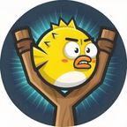

# 愤怒河豚的弹弓 · Puffer Go



一款原创海洋题材的**弹射闯关微信小游戏**。拉动弹弓把小河豚发射出去，砸塌章鱼怪的堡垒，讨伐章末的章王 Boss。

纯 Canvas 2D 手写渲染 + 自研轻量物理引擎，**零引擎依赖、零第三方库、零图片素材**——所有角色、场景、音效均由代码程序化生成。

- 🎯 40 个关卡（5 章 × 8 关），难度递进
- 🐙 5 只章王 Boss，多阶段怒吼机制
- 🐡 4 种河豚，各有专属技能与材质克制
- 🦪 12 颗隐藏珍珠 + 每日挑战

> **原创声明**：本项目为原创海洋题材（河豚族 vs 章鱼怪），角色形象、命名、配色、文案、音效与 BGM 全部原创，与任何现有游戏角色无关联。

---

## 🚀 快速开始

### 方式一：浏览器预览（零安装，最快）

直接用浏览器打开 `preview/index.html` 即可开玩，鼠标拖拽瞄准发射，触屏设备可直接手指操作。

> 原理：`build-preview.js` 把 CommonJS 模块打包成浏览器 IIFE（`preview/bundle.js`），`preview/index.html` 内置了 `wx` API 适配层（Canvas / 触摸 / 存储 / 震动）。

改动 `src/` 下源码后需重新打包：

```bash
node build-preview.js
```

### 方式二：微信开发者工具

1. 安装 [微信开发者工具](https://developers.weixin.qq.com/miniprogram/dev/devtools/download.html)（稳定版）
2. 新建项目 → 项目类型选 **「小游戏」**（不是小程序）
3. 项目目录选本仓库根目录，AppID 选 **「测试号 / 游客模式」**
4. 导入后即可在模拟器中游玩

> 仓库内 `project.config.json` 的 `appid` 为 `touristappid`（游客模式），无需审核即可预览。真机预览需替换为自有小游戏 AppID。

---

## 🕹️ 玩法与内容

### 四种河豚

| 河豚 | 技能 | 克制 |
|------|------|------|
| **嘟嘟** | 无技能，标准弹射 | 全材质均衡 |
| **梭梭** | 疾翎冲刺：空中点击，沿当前方向极速冲刺（速度 ×2.1） | 克木 ×2.0 |
| **砰砰** | 岩轰爆炸：空中点击或首次撞击触发范围爆炸（半径 110） | 克石 ×2.0 |
| **三丸子** | 三胞分裂：空中点击一分为三，上下偏转 | 克冰 ×2.0 |

关卡准备阶段点击候飞区的河豚可与弹弓上的河豚**换序**——出豚顺序由玩家决策，是通关的关键。

### 五只章王

| 章王 | 关卡 | HP | 外壳 | 机制 |
|------|------|----|------|------|
| 滩涂章王 | 第 8 关 | 5 | 木壳 | 教学关，无阶段怒吼 |
| 冰壳章王 | 第 16 关 | 7 | 冰壳 | 半血怒吼，天降爆裂果 |
| 岩甲章王 | 第 24 关 | 9 | 石壳 | 两阶段怒吼，天降落石 |
| 深渊章王 | 第 32 关 | 11 | 混合壳 | 三阶段，落石 + 召唤援军 |
| 潮汐王座·章王 | 第 40 关 | 14 | 双层壳 | 三阶段，落石 + 爆裂果 + 召唤 |

章王共性：**免疫击退**（巨物击不飞）、顶部有独立血条名牌（残血变红脉动）、血量跨阈值时震屏怒吼并唤醒屏外援军。讨伐成功 +5000 分。

游戏内「主菜单 → 玩法说明」有完整的河豚图鉴与章王图鉴。

### 其他系统

- **星级评价**：3 星制，基于分数门槛，只增不减
- **珍珠收集**：12 颗（6 颗藏于关卡场景飞行触碰拾取 / 5 颗章节全三星奖励 / 1 颗主菜单双击吉祥物彩蛋），每颗解锁一个确定性生成的珍珠关
- **每日挑战**：`src/daily.js` 按日期种子生成关卡
- **弹道残影**：上一发完整轨迹保留到下一发发射前，辅助瞄准修正

---

## 📁 项目结构

```
angry-birds/
├── game.js              # 入口（require 主逻辑）
├── game.json            # 小游戏配置（竖屏、无状态栏）
├── project.config.json  # 项目配置（appid=touristappid）
├── build-preview.js     # 浏览器预览打包器（CommonJS → IIFE）
├── verify-preview.js    # 浏览器预览端到端验证
├── src/
│   ├── config.js        # 全局配置：屏幕尺寸、物理常量、配色、功能开关
│   ├── utils.js         # 数学工具：向量运算、碰撞检测
│   ├── entities.js      # 游戏实体：河豚、章鱼怪、方块、粒子、按钮、气泡、珍珠
│   ├── levels.js        # 40 关数据（5 章×8，含风味名与隐藏珍珠坐标）
│   ├── pearls.js        # 珍珠收集系统
│   ├── daily.js         # 每日挑战生成器
│   ├── level-flow.js    # 关卡流程：装载/生成/候飞队列
│   ├── settle.js        # 结算：胜负判定、进度存档、结算动画、广告点位
│   ├── combat.js        # 战斗事件：技能/爆炸/击杀/摧毁/珍珠拾取
│   ├── effects.js       # 特效：粒子/飘字/震屏/撞击音效（对象池）
│   ├── input.js         # 输入：触摸分发（选中/重放/瞄准拖拽/滚动）
│   ├── physics.js       # 物理：碰撞检测与响应
│   ├── renderer.js      # 世界内绘制：背景/弹弓/弹道残影/HUD
│   ├── screens.js       # 全屏界面：菜单/章节化选关/设置/胜负结算
│   ├── theme.js         # 海洋主题绘制
│   ├── help.js          # 玩法说明页（河豚图鉴 + 章王图鉴）
│   ├── audio.js         # 音效管理器（封装 wx.createInnerAudioContext）
│   ├── ad.js            # 广告：激励视频 / 插屏 / 原生模板
│   └── game.js          # 主控制器：状态机、存档、主循环、渲染编排
├── tools/
│   ├── gen-sounds.js    # 音效合成器：程序化生成 WAV（零依赖、零版权素材）
│   ├── validate-levels.js # 关卡静态校验（几何/越界/珍珠可达/难度指标）
│   ├── e2e-tests.js     # 端到端行为测试
│   └── test-harness.js  # 测试环境（虚拟时钟 60Hz / 触摸 / 激励视频 mock）
├── sounds/              # 生成的音效文件
├── docs/                # 设计文档（广告接入方案等）
├── outputs/             # 交付物：正式头像、发布信息、备案文案
├── preview/             # 浏览器预览（index.html + 打包产物）
└── opendata/            # 好友排行榜开放数据域（当前已停用，见下）
```

---

## 🛠️ 开发

需要 **Node.js**，无需安装任何依赖（无 `package.json`、无第三方库）。

### 回归门

任何源码改动后，依次跑完四步且全绿才算完成：

```bash
node tools/validate-levels.js          # 关卡几何/越界/珍珠可达/难度指标
node tools/e2e-tests.js                # 端到端行为测试（当前 38 条断言）
node build-preview.js                  # 重新打包浏览器预览
node verify-preview.js                 # 浏览器预览端到端验证
```

其他命令：

```bash
node tools/gen-sounds.js               # 重新生成 sounds/ 下的音效
```

### 测试说明

- `tools/test-harness.js` 提供虚拟时钟（60Hz）、触摸事件与激励视频 mock，e2e 驱动的是**真实游戏单例**而非替身。
- e2e 中包含若干**不变量断言**，防止历史问题回潮，例如：水体渐变必须是「上浅下深」、气泡必须向上浮、排行榜隐藏后必须能通过开关完整恢复。

### 功能开关

`src/config.js` 的 `FEATURES`：

```js
const FEATURES = {
  leaderboard: false,   // 好友排行榜，默认关闭
};
```

好友排行榜依赖 `wx.setUserCloudStorage` + 开放数据域，需要小程序后台配置「用户隐私保护指引」与后端数据服务，故默认隐藏。恢复需同时满足：开关置 `true` → `game.json` 恢复 `"openDataContext": "opendata"` → `project.config.json` 的 ignore 移除 `opendata` → 后台补齐隐私指引并通过审核。

---

## 📦 发版注意事项

### 主包 4MB 上限

微信小游戏主包上限 4MB。仓库里 `outputs/`、`tools/`、`docs/`、`preview/` 等非运行资源已通过 `project.config.json` 的 `packOptions.ignore` 标记为不上传（文件保留在磁盘，机制可逆），上传包约 **0.78MB**。

> ⚠️ `packOptions.ignore` 的字段名是 **`value`** 不是 `path`，写错会报 `packOptions.ignore[x].value should not be empty`。
> ⚠️ 上报错误码 **80051** 即 `source size exceed max limit 4MB`。
> ⚠️ `sounds/`（约 484KB）是运行时音频，**不可**加入 ignore。

### 广告位 ID（上线前必做）

`src/ad.js` 顶部 `AD_UNIT` 目前是占位值：

```js
const AD_UNIT = {
  reward: 'adunit-0000000000000000',       // 激励视频
  interstitial: 'adunit-0000000000000001', // 插屏
  banner: 'adunit-0000000000000002',       // 原生模板
};
```

必须替换为微信公众平台「流量主 → 广告位管理」创建的真实广告位 ID，否则广告加载失败、收益恒为 0（占位 ID 下模块会自动降级，不影响玩法）。

广告点位策略：激励视频 3 处（失败复活 / 结算双倍 / 卡关弹道全显）、插屏仅退出关卡并按频控（首 2 次不弹，之后每 3 次 1 次，60 秒冷却）、原生模板横幅仅选关页且做布局避让。**WIN → 「下一关」的连闯路径绝不插广告**。详见 `docs/广告接入方案.md`。

### 上架资质（提醒，非技术项）

游戏类目不支持纯个人主体发布，需企业/组织主体 +《增值电信业务经营许可证》+ 版号或走休闲游戏绿色通道，并配置用户隐私协议。仓库内 `outputs/` 提供了发布信息与备案文案：

- `outputs/mini-program-info.md` — 名称 / 简称 / 介绍 / 三字段文案
- `outputs/audit-content-20260901.md` — 备案「填写游戏内容」场景描述、玩法设计、系统功能说明与截图清单
- `outputs/puffer-avatar-144x144.png` — 正式头像；`outputs/puffer-avatar-1024x1024.png` 为 1024 原图

---

## 🗂️ 版本历史

| 版本 / 标签 | 内容 |
|-------------|------|
| **release-1.0** | 首个上线版本：玩法说明页、游戏内世界海洋化、广告接入、排行榜隐藏、主菜单重排、上传包体瘦身至 0.78MB |
| T4 | 章末 Boss 战：5 只章王 + 阶段怒吼 + 讨伐结算 |
| T3 | 选关页视觉重做 + 选豚换序 |
| T2 | 40 关重构（5 章 × 8）、选关页章节卡片 |
| T1 | 架构拆分（game.js 1527 → 689 行）、测试固化、章节化 |

详细的迭代记录见 [`overview.md`](overview.md)。

---

## 📄 说明

- 项目目录名沿用历史的 `angry-birds`，但游戏本体已于早期完成题材级原创化，与目录名无关。
- 若无特殊说明，代码注释为中文，变量与函数名为英文。
- 本项目仅供学习交流使用，上架发布需自行满足微信平台与相关法规要求。
